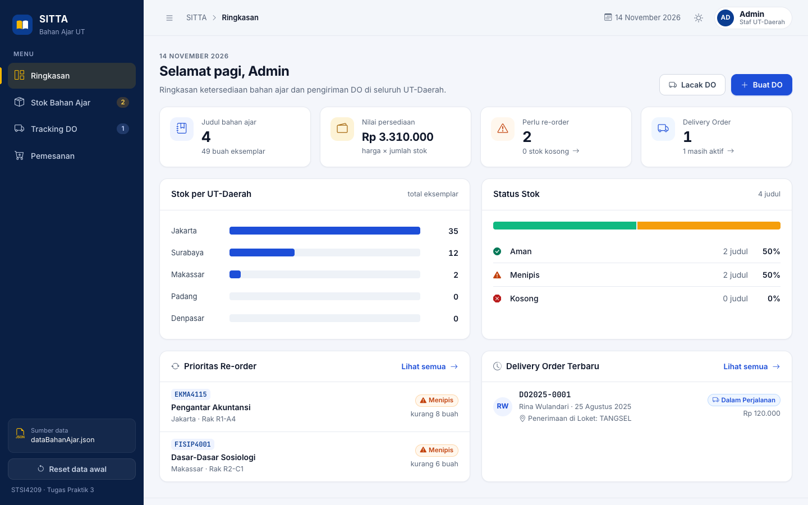
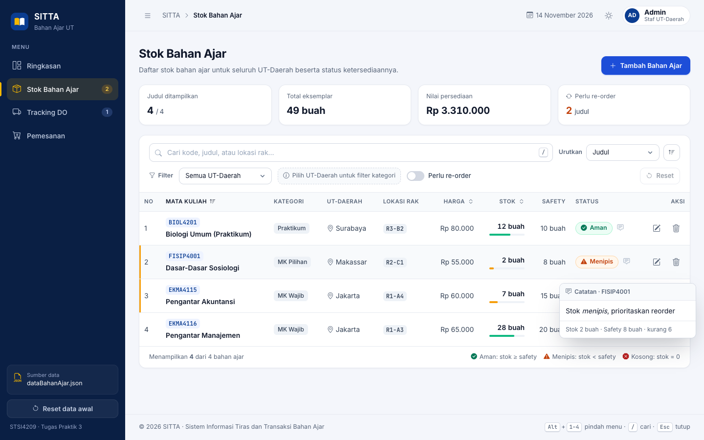
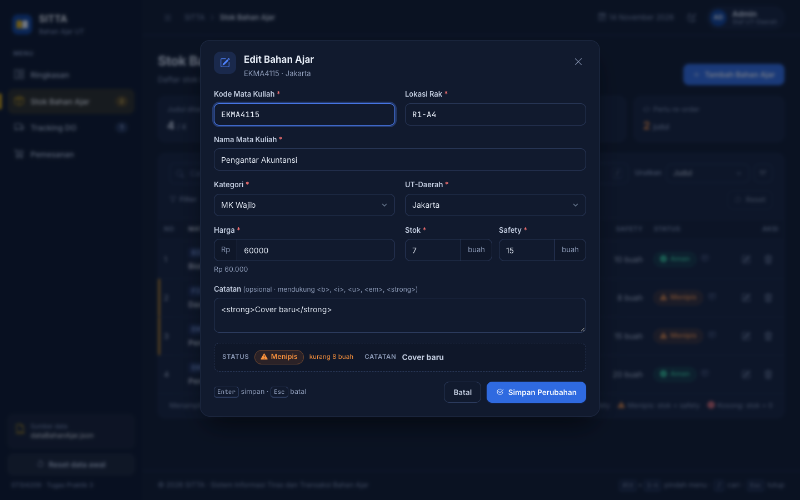
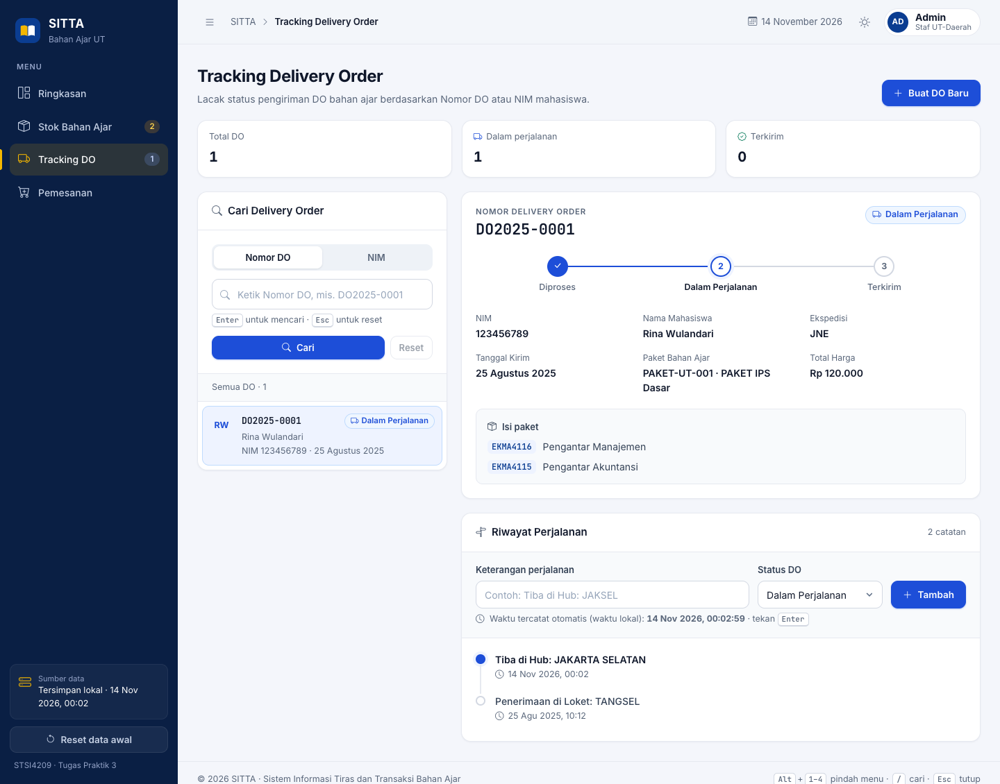
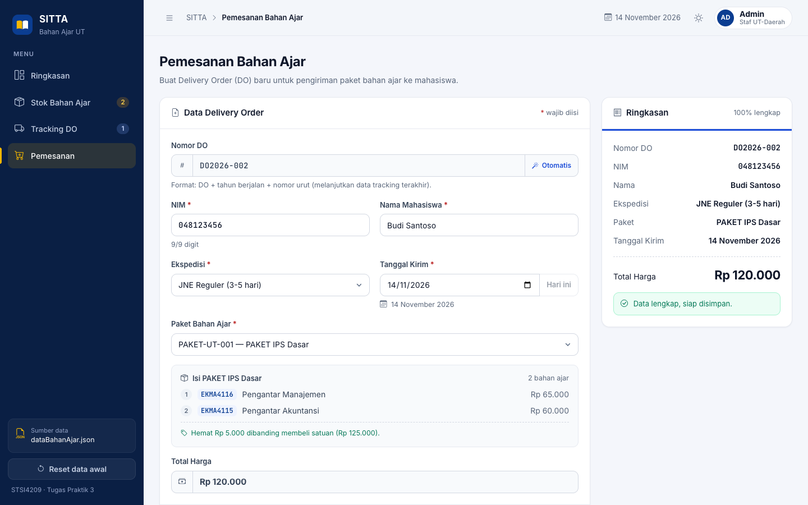
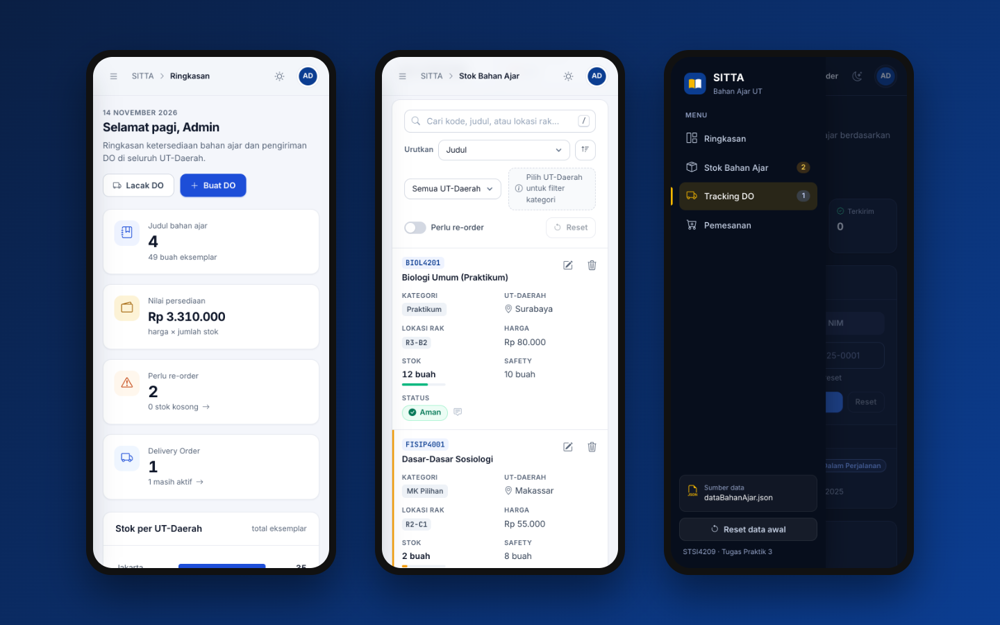
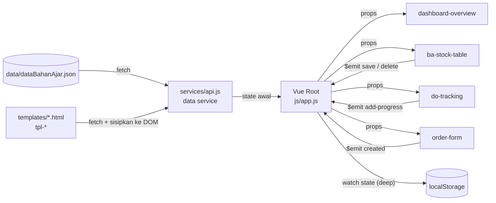

<div align="center">


# SITTA — Sistem Pemesanan & Distribusi Bahan Ajar

**Aplikasi dashboard berbasis Vue.js untuk mengelola stok bahan ajar, pemesanan, dan pelacakan Delivery Order (DO) di lingkungan UT-Daerah.**

Tugas Praktik 3 · STSI4209 Pemrograman Berbasis Web · Universitas Terbuka<br>
**Yaya Sunarya** · NIM 056860328 · Sistem Informasi · UPBJJ UT Bandung

[](https://v2.vuejs.org/)
[](https://developer.mozilla.org/docs/Web/JavaScript)
[](https://developer.mozilla.org/docs/Web/HTML)
[](https://developer.mozilla.org/docs/Web/CSS)
[](#-memulai)
[](#-desain--aksesibilitas)

[Fitur](#-fitur-utama) · [Tangkapan Layar](#-tangkapan-layar) · [Memulai](#-memulai) · [Arsitektur](#-arsitektur) · [Pemetaan Kriteria](#-pemetaan-kriteria-penilaian)

<br>

<picture>
  <source media="(prefers-color-scheme: dark)" srcset="docs/screenshots/dashboard-dark.png">
  
</picture>

</div>

---

## Daftar Isi

- [Tentang Proyek](#-tentang-proyek)
- [Fitur Utama](#-fitur-utama)
- [Tangkapan Layar](#-tangkapan-layar)
- [Teknologi](#-teknologi)
- [Memulai](#-memulai)
- [Panduan Penggunaan](#-panduan-penggunaan)
- [Arsitektur](#-arsitektur)
- [Struktur Proyek](#-struktur-proyek)
- [Pemetaan Kriteria Penilaian](#-pemetaan-kriteria-penilaian)
- [Desain & Aksesibilitas](#-desain--aksesibilitas)
- [Catatan Data & Keputusan Desain](#-catatan-data--keputusan-desain)
- [Kompatibilitas Browser](#-kompatibilitas-browser)
- [Referensi](#-referensi)
- [Penyusun](#-penyusun)

---

## 📌 Tentang Proyek

**SITTA** (Sistem Informasi Tiras dan Transaksi Bahan Ajar) adalah simulasi aplikasi internal untuk proses pemesanan dan distribusi bahan ajar Universitas Terbuka. Proyek ini merupakan refaktor dari Tugas Praktik 2: halaman web dipecah menjadi **Vue Component** dan **Template** yang terpisah, dengan arsitektur yang rapi dan mudah dikembangkan.

Tujuan utamanya adalah menerapkan konsep inti Vue.js, yaitu komponen, template, data binding, directive, conditional, computed, methods, watcher, dan filter, dalam sebuah aplikasi yang utuh dan nyaman digunakan.

> [!NOTE]
> Data aplikasi bersumber dari file JSON dummy (`data/dataBahanAjar.json`), bukan database. Aplikasi ini adalah proyek akademik dan **bukan** sistem resmi Universitas Terbuka.

---

## ✨ Fitur Utama

### 📦 Stok Bahan Ajar
- Daftar stok seluruh UT-Daerah: kode & judul, kategori, UT-Daerah, lokasi rak, harga (**Rp**), stok & safety stock (**buah**), serta status.
- **Status otomatis** dengan ikon dan warna: 🟢 **Aman** (stok ≥ safety), 🟠 **Menipis** (stok < safety), 🔴 **Kosong** (stok = 0).
- **Tooltip catatan** (`catatanHTML`) muncul saat kursor diarahkan ke kolom Status.
- **Filter bertingkat (dependent):** filter kategori baru muncul setelah UT-Daerah dipilih.
- Filter **Perlu re-order** (stok < safety atau stok = 0), pencarian teks, **sort** berdasarkan judul / stok / harga, serta **reset** filter.
- **CRUD lengkap** melalui formulir modal dengan validasi per field. Tekan **Enter** untuk menyimpan, dan penghapusan selalu melalui **pop up konfirmasi**.

### 🚚 Tracking Delivery Order
- Pencarian berdasarkan **Nomor DO** atau **NIM**. Tekan **Enter** untuk mencari dan **Esc** untuk mereset.
- Detail DO lengkap: stepper status (Diproses → Dalam Perjalanan → Terkirim), informasi penerima, dan isi paket.
- **Riwayat perjalanan** berbentuk timeline, dengan penambahan progress baru yang waktunya dicatat otomatis dari jam lokal (`Date`).

### 🛒 Pemesanan (DO Baru)
- **Nomor DO otomatis**: `DO` + tahun berjalan + nomor urut (mis. `DO2026-002`).
- Pilihan ekspedisi (JNE Reguler / Ekspres) dan paket bahan ajar. **Isi paket** langsung tampil setelah paket dipilih.
- Tanggal kirim diformat Indonesia (mis. *25 Agustus 2025*), dan **total harga** terisi otomatis dari data paket.
- Ringkasan pesanan *live preview* dan validasi sebelum disimpan.

### 🧭 Pengalaman Pengguna
- Layout **dashboard** dengan sidebar yang bisa diciutkan, halaman **Ringkasan** berisi KPI dan grafik stok per UT-Daerah.
- Tema **Sistem / Terang / Gelap**: default mengikuti pengaturan perangkat dan ikut berganti saat tema OS berubah.
- **Responsif** di HP, tablet, dan desktop; di layar kecil tabel stok berubah menjadi kartu.
- Notifikasi *toast*, *empty state*, *skeleton loading*, dan **shortcut keyboard**.
- Perubahan data tersimpan otomatis di `localStorage`, dan bisa dikembalikan ke data awal dengan sekali klik.

---

## 🖼 Tangkapan Layar

<table>
  <tr>
    <td width="50%"><p align="center"><sub><b>Stok Bahan Ajar</b> — status, filter, dan tooltip catatan</sub></p></td>
    <td width="50%"><p align="center"><sub><b>Form Edit</b> — validasi & pratinjau status (mode gelap)</sub></p></td>
  </tr>
  <tr>
    <td width="50%"><p align="center"><sub><b>Tracking DO</b> — stepper status & riwayat perjalanan</sub></p></td>
    <td width="50%"><p align="center"><sub><b>Pemesanan</b> — nomor DO otomatis & ringkasan pesanan</sub></p></td>
  </tr>
</table>

<p align="center">
  
  <br><sub><b>Tampilan mobile</b> — ringkasan, tabel stok sebagai kartu, dan drawer navigasi</sub>
</p>

---

## 🛠 Teknologi

| Lapisan | Teknologi | Keterangan |
|---|---|---|
| Framework | [Vue.js 2.7.16](https://v2.vuejs.org/) (CDN) | Vue 2 dipakai karena mendukung **filter**, salah satu indikator capaian tugas |
| Bahasa | HTML5, CSS3, JavaScript (ES2020) | Tanpa build tool / bundler, langsung jalan di browser |
| Ikon | [Bootstrap Icons 1.11.3](https://icons.getbootstrap.com/) | Melalui CDN jsDelivr |
| Tipografi | Inter & JetBrains Mono | Melalui Google Fonts |
| Data | JSON statis + `localStorage` | `fetch()` untuk data awal, `localStorage` untuk menyimpan perubahan |

---

## 🚀 Memulai

### Prasyarat
- Browser modern (Chrome, Edge, Firefox, atau Safari versi terbaru).
- Salah satu web server lokal: ekstensi **Live Server** di VS Code, **Python 3**, **Node.js**, atau **PHP**.

> [!IMPORTANT]
> Aplikasi memuat template dan data JSON menggunakan `fetch()`, sehingga **harus dijalankan melalui web server lokal**. Membuka `index.html` langsung (`file://`) akan diblokir browser, dan aplikasi menampilkan petunjuk cara menjalankannya.

### Instalasi & Menjalankan

```bash
# 1. Clone repositori
git clone https://github.com/yasunstudio/tugas3-vue-ut.git
cd tugas3-vue-ut

# 2. Jalankan web server lokal (pilih salah satu)
python3 -m http.server 8080      # Python
npx serve -l 8080 .              # Node.js
php -S localhost:8080            # PHP

# 3. Buka di browser
#    http://localhost:8080
```

**Alternatif VS Code:** klik kanan `index.html`, lalu pilih **Open with Live Server**.

---

## 📖 Panduan Penggunaan

### Shortcut Keyboard

| Tombol | Fungsi |
|---|---|
| <kbd>Alt</kbd> + <kbd>1</kbd> – <kbd>4</kbd> | Pindah menu: Ringkasan, Stok, Tracking DO, Pemesanan |
| <kbd>/</kbd> | Fokus ke kolom pencarian (halaman Stok & Tracking) |
| <kbd>Enter</kbd> | Simpan formulir, jalankan pencarian, tambah progress, setujui konfirmasi |
| <kbd>Esc</kbd> | Reset pencarian, tutup modal / menu tema / drawer navigasi |
| <kbd>Ctrl</kbd> / <kbd>⌘</kbd> + <kbd>Enter</kbd> | Simpan formulir saat kursor berada di kolom catatan (textarea) |
| <kbd>↑</kbd> <kbd>↓</kbd> | Berpindah pilihan pada menu tema |

### Penyimpanan Data

Setiap perubahan (tambah / edit / hapus stok, DO baru, progress perjalanan) otomatis disimpan di `localStorage` browser:

| Key | Isi |
|---|---|
| `sitta-ut:state:v1` | Seluruh data aplikasi beserta waktu penyimpanan terakhir |
| `sitta-ut:theme` | Pilihan tema manual (tidak ada = ikuti sistem) |
| `sitta-ut:sidebar-collapsed` | Status sidebar diciutkan di desktop |

Tombol **Reset data awal** di sidebar menghapus perubahan dan memuat ulang isi `dataBahanAjar.json`.

---

## 🏗 Arsitektur

Aplikasi menerapkan pola **one-way data flow**. Vue root (`js/app.js`) menjadi *single source of truth*: state dikirim ke komponen melalui **props**, dan setiap perubahan dikirim kembali ke root melalui **event (`$emit`)**. Hanya root yang memodifikasi state.



### Alur Bootstrap
1. `services/api.js` memuat seluruh file `templates/*.html` (berisi `<template id="tpl-...">`) ke DOM.
2. `new Vue({ el: '#app' })` di-mount, dan komponen membaca template melalui opsi `template: '#tpl-...'`.
3. Root memanggil `Api.loadState()`, yang memakai salinan `localStorage` bila ada atau mengambil ulang file JSON.
4. Data dinormalisasi (mis. `tracking` diubah menjadi object ber-key Nomor DO), lalu dirender.

### Komponen

| Komponen | File | Template | Tanggung jawab |
|---|---|---|---|
| `<ba-stock-table>` | `stock-table.js` | `tpl-stock` | Halaman stok: daftar, filter, sort, tooltip, aksi CRUD |
| `<ba-stock-form>` | `stock-form.js` | `tpl-stock-form` | Form create / update bahan ajar dengan validasi |
| `<do-tracking>` | `do-tracking.js` | `tpl-tracking` | Pencarian DO, detail, riwayat & progress perjalanan |
| `<order-form>` | `order-form.js` | `tpl-order` | Form DO baru dengan nomor otomatis |
| `<dashboard-overview>` | `dashboard-overview.js` | `tpl-dashboard` | KPI, grafik stok, prioritas re-order, DO terbaru |
| `<status-badge>` | `status-badge.js` | `tpl-badge` | Badge Aman / Menipis / Kosong dan status DO |
| `<app-modal>` | `app-modal.js` | `tpl-modal` | Modal formulir & pop up konfirmasi (Promise) |
| `<app-toast>` | `app-toast.js` | `tpl-toast` | Notifikasi singkat |
| `<theme-switcher>` | `theme-switcher.js` | `tpl-theme` | Pilihan tema Sistem / Terang / Gelap (`v-model`) |

---

## 📁 Struktur Proyek

```
tugas3-vue-ut/
├── index.html                  # Root: mount #app, layout dashboard, routing via tab state
├── assets/
│   ├── css/style.css           # Gaya global: design token, tema terang/gelap, responsif
│   └── img/logo.svg
├── data/
│   └── dataBahanAjar.json      # Sumber data (JSON)
├── js/
│   ├── app.js                  # Inisialisasi Vue root: state, computed, watcher, handler
│   ├── filters.js              # Filter global: rupiah, satuan, tanggal, waktu, angka, inisial
│   ├── services/
│   │   └── api.js              # Data service: fetch JSON, loader template, localStorage, helper
│   └── components/             # Satu file per komponen (kebab-case)
│       ├── stock-table.js      ├── stock-form.js       ├── do-tracking.js
│       ├── order-form.js       ├── dashboard-overview.js
│       ├── status-badge.js     ├── app-modal.js        ├── app-toast.js
│       └── theme-switcher.js
├── templates/                  # <template id="tpl-..."> — satu file per komponen
│   ├── stock-table.html        ├── stock-form.html     ├── do-tracking.html
│   ├── order-form.html         ├── dashboard-overview.html
│   ├── status-badge.html       ├── app-modal.html      ├── app-toast.html
│   └── theme-switcher.html
└── docs/                       # Lampiran soal, format laporan, dan tangkapan layar
```

**Konvensi penamaan:** file komponen memakai *kebab-case* dan diregistrasikan dengan `Vue.component('nama-komponen', { template: '#tpl-...' })`. Id template konsisten dengan awalan `tpl-`.

---

## ✅ Pemetaan Kriteria Penilaian

Pemetaan kriteria penilaian Tugas Praktik 3 ke implementasinya:

| No | Kriteria | Implementasi |
|---|---|---|
| 1.1 | **Arsitektur & struktur proyek** | Struktur folder sesuai soal, file kebab-case, `Vue.component('ba-stock-table', ...)`, id template `tpl-*`, data service terpisah (`services/api.js`), routing lewat `tab` di root |
| 1.2 | **Data binding, directive, array & filter** | Mustache `{{ }}`, `v-text`, `v-html` (catatan, sudah disanitasi), `v-bind` (`:class`, `:style`, props), `v-model`. `v-for` dengan **index angka** (`(item, index) in sortedItems`) dan **index nama** (`(value, label) in detailFields`). Filter `rupiah`, `satuan`, `tanggal`, `waktu` |
| 1.3 | **Conditional** | Rantai `v-if="qty === 0"` → `v-else-if="qty < safety"` → `v-else` di `<status-badge>`; state loading / error / konten; `v-show` untuk tab dan chip filter; filter kategori dependent `v-if="filter.upbjj"` |
| 1.4 | **Computed & methods** | Rantai computed `items → filteredItems → sortedItems` (di-cache, sehingga mengganti sort tidak mengulang filter), `kategoriOptions`, `errors` (validasi), `nextDoNumber`, KPI dashboard; methods untuk CRUD, sort, pencarian, progress |
| 1.5 | **Watchers (minimal 2)** | 18 watcher, antara lain `filter.upbjj` (reset kategori), `form.paket` (isi total harga), `form.nim` (hanya angka), `state` deep (autosave), `tab` (judul & URL), `themePref` / `theme` |
| 1.6 | **Form, validasi & event mouse / keyboard** | Validasi per field; **Enter** untuk simpan / cari / tambah progress; **Esc** untuk reset & tutup; `@mouseenter` / `@mouseleave` untuk tooltip; klik header untuk sort; shortcut global |
| 1.7 | **Kreativitas antarmuka** | Layout dashboard, KPI & grafik, stepper & timeline DO, live preview form, toast, tema Sistem/Terang/Gelap, responsif, kontras WCAG AA |

<details>
<summary><b>Rincian butir instruksi soal yang dipenuhi</b></summary>

<br>

**Halaman Stok Bahan Ajar**
- [x] Kolom kode/judul, kategori, UT-Daerah, lokasi rak, harga (Rp), stok & safety (buah), status
- [x] Tooltip `catatanHTML` saat hover kolom Status
- [x] Edit stok, filter UT-Daerah & kategori (dependent), filter re-order, sort judul/stok/harga, reset filter
- [x] Filter memakai computed sehingga tidak perlu *recompute*
- [x] Status Aman (hijau), Menipis (oranye), Kosong (merah) dengan simbol
- [x] Create & update melalui form + validasi, simpan dengan **Enter**
- [x] Hapus melalui tombol dengan pop up konfirmasi

**Tracking Delivery Order**
- [x] Cari berdasarkan Nomor DO atau NIM, **Enter** untuk submit, **Esc** untuk reset
- [x] Input DO baru: nomor otomatis, NIM, nama, ekspedisi, paket (`<select>` kode + nama) dengan detail isi, tanggal kirim terformat, total harga (Rp), validasi
- [x] Tambah progress perjalanan: waktu dari `Date` lokal, keterangan dari input pengguna

</details>

---

## 🎨 Desain & Aksesibilitas

- **Design token** berbasis CSS custom properties dengan palet identitas UT (navy & emas), sehingga tema terang dan gelap konsisten di semua komponen.
- **Kontras teks** memenuhi **WCAG 2.1 AA** (≥ 4,5 : 1) di kedua tema.
- **Navigasi keyboard penuh:** fokus terlihat (`:focus-visible`), fokus otomatis saat modal dibuka, serta tombol Esc / Enter / panah.
- **ARIA:** `aria-expanded`, `aria-current`, `role="dialog"`, `role="menu"` / `menuitemradio`, dan label pada tombol ikon.
- **Keamanan:** konten `catatanHTML` disanitasi (whitelist tag format teks, atribut dihapus) sebelum dirender dengan `v-html` untuk mencegah XSS.
- Menghormati `prefers-reduced-motion` dan `prefers-color-scheme`.

---

## 📝 Catatan Data & Keputusan Desain

| Topik | Keputusan |
|---|---|
| Data `tracking` duplikat | JSON berisi entri `DO2025-0001` dua kali. Saat dimuat, data dinormalisasi menjadi object ber-key Nomor DO sehingga duplikat diabaikan |
| Format nomor DO | Data awal memakai 4 digit (`DO2025-0001`), contoh soal 3 digit. DO baru mengikuti soal dan melanjutkan nomor urut terbesar: `DO<tahun>-002`, `-003`, dst. |
| Sumber opsi ekspedisi & kategori | Soal menyebut `upbjjList`; sesuai konteks dipakai `pengirimanList` (ekspedisi) dan `kategoriList` (kategori) |
| Lokasi template | Template disimpan di `/templates/` sesuai struktur soal dan dimuat via `fetch()`, sehingga aplikasi perlu web server lokal |
| Form DO baru | Ditempatkan di tab **Pemesanan** (`order`) sesuai contoh `index.html` di soal, dengan pintasan dari halaman Tracking |

---

## 🌐 Kompatibilitas Browser

Diuji pada Google Chrome versi terbaru (desktop & emulasi mobile). Aplikasi memakai fitur web modern seperti `fetch`, `ResizeObserver`, CSS custom properties, `color-mix()`, dan optional chaining, sehingga disarankan menggunakan **Chrome / Edge 111+**, **Firefox 113+**, atau **Safari 16.2+**.

---

## 📚 Referensi

- Sufandi, U. U., Aprijani, D. A., & Pandiangan, P. (2021). Evaluasi dan hasil review desain user interface prototype aplikasi mobile SITTA Universitas Terbuka. *Jurnal Nasional Pendidikan Teknik Informatika: JANAPATI, 10*(3), 147–156. https://doi.org/10.23887/janapati.v10i3.40281
- Sufandi, U. U. (2022). Analisis kebutuhan dan dokumentasi Sistem Informasi Tiras dan Transaksi Bahan Ajar Universitas Terbuka. *Jurnal Nasional Pendidikan Teknik Informatika: JANAPATI, 11*(2), 112–122. https://doi.org/10.23887/janapati.v11i2.42966
- Vue.js. (n.d.). *Vue 2 documentation*. https://v2.vuejs.org/v2/guide/
- W3Schools. (n.d.). *How to create a modal box*. https://www.w3schools.com/howto/howto_css_modals.asp
- W3Schools. (n.d.). *JavaScript date methods*. https://www.w3schools.com/js/js_date_methods.asp

---

## 👤 Penyusun

Dikembangkan sebagai pemenuhan **Tugas Praktik 3** mata kuliah **STSI4209 Pemrograman Berbasis Web**, Universitas Terbuka.

| Biodata | Keterangan |
|---|---|
| **Nama** | Yaya Sunarya |
| **NIM** | 056860328 |
| **Program Studi** | Sistem Informasi |
| **Fakultas** | Sains dan Teknologi |
| **UPBJJ UT** | Bandung |
| **GitHub** | [@yasunstudio](https://github.com/yasunstudio) |

<div align="center">
<sub>Proyek akademik · Data yang digunakan adalah data dummy dari lampiran tugas.</sub>
</div>
